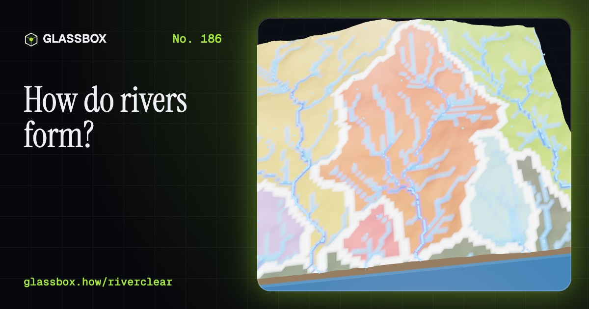
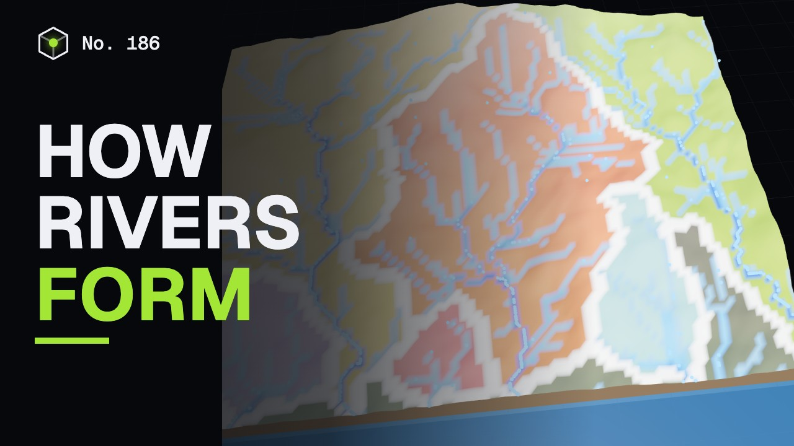
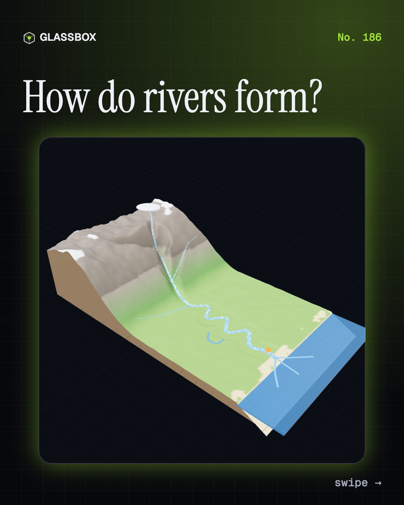
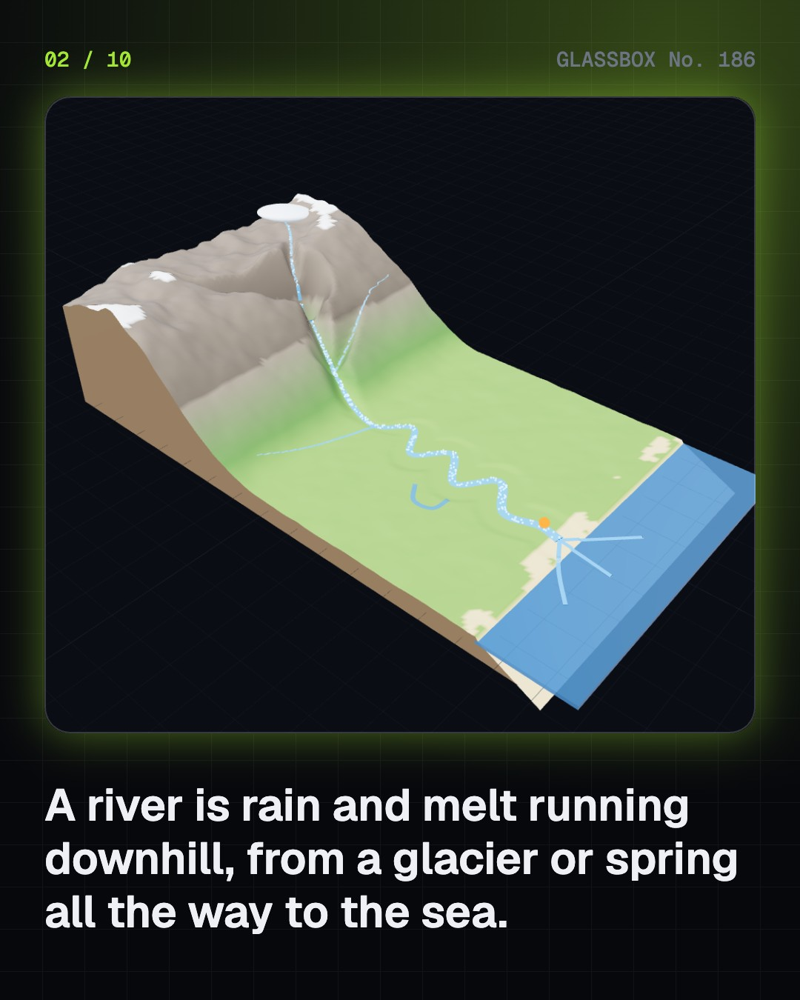
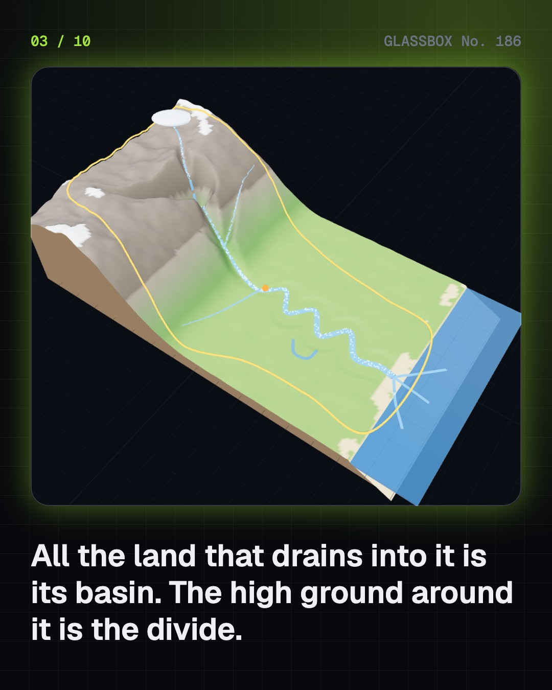
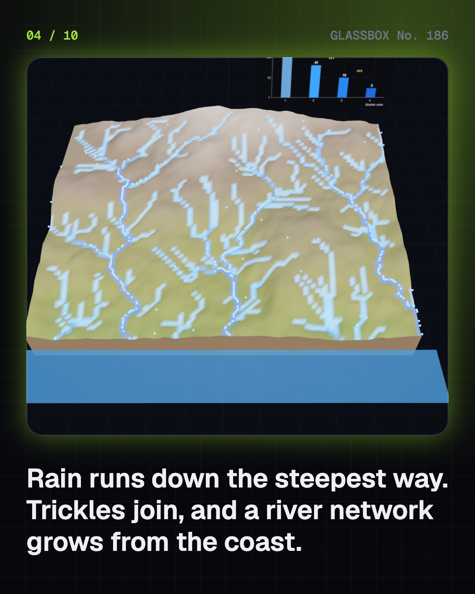

<!-- glassbox:start -->
<!-- Generated from glassbox.json by the Glassbox hub (npm run readme -- riverclear). Edit glassbox.json, not this block. -->
<p align="center"><a href="https://glassbox.how/e/riverclear/"></a></p>

<h1 align="center">RiverClear</h1>

<p align="center"><b>How do rivers form?</b><br>Nobody digs a river: rain does. Rain on a landscape and watch a river network grow, lift sand and drop mud, walk a waterfall upstream, let meanders cut themselves off into oxbow lakes, build a delta, and follow the Ganga from Gaumukh to the Sundarbans.</p>

<p align="center"><a href="https://glassbox.how/riverclear/"><b>▶ Play with it</b></a> &nbsp;·&nbsp; <a href="https://glassbox.how/e/riverclear/">Read the 60-second explainer</a> &nbsp;·&nbsp; <a href="https://glassbox.how/riverclear/glassbox/reel.mp4">Watch the 40-second video</a></p>

<p align="center">
  <a href="https://glassbox.how/e/riverclear/"></a>
  <a href="https://glassbox.how/e/riverclear/"></a>
  <a href="LICENSE"></a>
  <a href="LICENSE-CONTENT.md"></a>
  <a href="#privacy"></a>
</p>

## In 60 seconds

1. **Source to sea.** A river is rain and melt running downhill to the sea. The Bhagirathi leaves the Gangotri glacier at Gaumukh, at about 3,900 m, and the Ganga runs about 2,525 km to the Bay of Bengal. Steep in the hills, it cuts down into V-shaped valleys; on the plain it meanders and spreads silt; at the sea it builds a delta.
2. **Water finds a way.** Every drop runs down the steepest slope, so trickles join into streams and streams into a river: a network that branches like a tree. All the land draining to one river is its basin, ringed by a divide; the Ganga basin covers 861,404 km² of India, nearly 26 % (CWC). Each stream order has about three to five times fewer streams than the one below.
3. **Lift, carry, drop.** Whether a river lifts, carries or drops a grain depends on speed and size. Sand of about 0.2 mm moves most easily; settled clay sticks together and needs fast water; once lifted, mud stays up almost indefinitely. Fast rivers grind out V-shaped valleys and gorges, and waterfalls eat their way upstream: Niagara has moved about 11 km in about 12,000 years.
4. **Meanders and deltas.** On flat land the fastest water swings to the outside of each bend and wears it away, while sand builds a point bar on the inside, so loops grow until they cut themselves off as oxbow lakes. At the sea the river drops its load and builds a delta lobe by lobe, like the Ganga–Brahmaputra delta and its Sundarbans mangroves. Braided and shifting rivers such as the Brahmaputra and the Kosi carry more sediment than they can hold.
5. **Water and mud.** Discharge is width × depth × speed, with the speed set by slope, depth and roughness (Manning's equation). The Ganga at Farakka averaged about 12,000 m³/s over 1949–73, with a record peak about five times that. Together the Ganga and Brahmaputra carry roughly 650 million to 1.8 billion tonnes of sediment a year to the sea, depending on the study.
6. **Rivers and people.** Cities from the Indus civilisation onwards grew by rivers, and the Ganga is revered as a goddess. Dams and barrages such as Tehri (2006), Farakka (1975) and Sardar Sarovar (2017) store and divert water but trap silt and displace people; the Ken–Betwa link began in 2024; Namami Gange (2015) treats sewage. Playfair, Hjulström, Horton, Strahler and the Central Water Commission (1945) shaped how we understand rivers.

## Words worth knowing

| Term | Meaning |
|---|---|
| **Drainage basin** | All the land that drains into one river and its tributaries; also called a catchment. |
| **Divide** | The high ground between two basins: rain on either side flows to different rivers. |
| **Stream order** | Strahler's numbering: unbranched streams are order 1, and two streams of order n make order n + 1. |
| **Baseflow** | The part of a river's flow that seeps in from groundwater and keeps it running between rains. |
| **Hjulström curve** | A chart of the water speeds that lift, carry and drop grains of each size. |
| **Meander** | A loop on a lowland river that grows as the outer bank wears away and the inner bank builds a point bar. |
| **Oxbow lake** | A curved lake left when a river cuts through the neck of a meander. |
| **Delta** | Land built of river sediment where a river meets still water, crossed by distributaries. |
| **Discharge** | The volume of water flowing past a point each second: width × depth × average speed. |

## A short history

**From cities built on the Indus floods to satellites measuring rivers from orbit: how people learned that rivers make their own valleys, plains and deltas.**

- **2600 BCE** · Cities on the Indus (The Harappan (Indus Valley) civilisation, Harappa and Mohenjo-daro)
- **1674** · Is there enough rain? (Pierre Perrault, Paris)
- **1802** · Every river cuts its own valley (John Playfair, Edinburgh)
- **1935** · Lift, carry, drop (Filip Hjulström, Uppsala)
- **1945** · Horton's laws (Robert E. Horton, Voorheesville, New York)
- **1945** · India's water commission is founded (B. R. Ambedkar and A. N. Khosla, Delhi)
- **2015** · Namami Gange (Union Cabinet, Delhi)

The full story, with 30 moments, charts, people and 40 sources: [glassbox.how/e/riverclear/history](https://glassbox.how/e/riverclear/history/). The data lives in [`history.json`](history.json).

## Video and slides

Made with the Glassbox studio from this box's storyboard (`window.glassbox.director`). Free to reuse under CC BY 4.0.

<a href="https://glassbox.how/riverclear/glassbox/video.mp4"></a>

<p><a href="glassbox/slide-1.jpg"></a> <a href="glassbox/slide-2.jpg"></a> <a href="glassbox/slide-3.jpg"></a> <a href="glassbox/slide-4.jpg"></a></p>

| File | What | Size |
|---|---|---|
| [`glassbox/reel.mp4`](https://glassbox.how/riverclear/glassbox/reel.mp4) | Reel / Short, with captions and soundtrack | 1080×1920 |
| [`glassbox/video.mp4`](https://glassbox.how/riverclear/glassbox/video.mp4) | YouTube video, with captions and soundtrack | 1920×1080 |
| `glassbox/slide-1…10.jpg` | Instagram carousel | 1080×1350 |
| `glassbox/thumb.jpg` | YouTube thumbnail | 1280×720 |
| `glassbox/cover.jpg` | Share card and repo social preview | 1200×630 |
| [`glassbox/history-reel.mp4`](https://glassbox.how/riverclear/glassbox/history-reel.mp4) | “History in 10 moments” Reel / Short | 1080×1920 |
| `glassbox/history-slide-*.jpg` | History carousel | 1080×1350 |
| `glassbox/post.json` | Post copy and schedule used by the publish kit | |

## Privacy

This box has no accounts and no ads, and it ships its own fonts and libraries. When you run it yourself it sends nothing anywhere. On glassbox.how, the site's `/bar.js` also loads Glassbox's analytics: **Google Analytics** to count visits (it asks first in the EU, UK and Switzerland, and stays off when your browser sends Global Privacy Control or Do Not Track) and **ClickTrust** to detect bots.

It remembers a few things **in your own browser only**, and never sends them anywhere:

| Browser storage key | What it holds |
|---|---|
| `riverclear.v1` | Which chapters you have opened, your best quiz scores, and sound on or off. |

Exactly what each one sees is at [glassbox.how/privacy](https://glassbox.how/privacy/).

## Licences

- **Code:** [MIT](LICENSE). Use it, change it, ship it.
- **Explanations, text, images and videos** (`glassbox.json`, `glassbox/`): [CC BY 4.0](LICENSE-CONTENT.md). Credit “Glassbox, glassbox.how/e/riverclear”.
- **Third-party parts** keep their own licences: [three.js](https://threejs.org) (MIT), [Geist, Instrument Serif](https://openfontlicense.org) (SIL OFL 1.1).
- The Glassbox name and logo aren't covered by either licence. See the [terms](https://glassbox.how/terms/).

Found a mistake? [Open an issue](https://github.com/bdeeps/riverclear/issues). Corrections happen in public.
<!-- glassbox:end -->

## Run it

It's plain HTML, CSS and JavaScript. No build step and no dependencies. Run locally, it contacts no other website.

```bash
python3 -m http.server 8000
```

Three.js and the fonts ship in `vendor/` and `fonts/`, so it also works offline.

Then open http://localhost:8000.

## How it's built

| File | What |
|---|---|
| `index.html`, `css/app.css` | The page and its styles |
| `js/app.js`, `js/stage.js`, `js/ui.js`, `js/kit.js` | The shared Glassbox 3D engine: chapters, 3D stage, controls, quiz, video director |
| `js/chapters/*.js` | One file per chapter: the 3D model, controls, text, key terms, quiz and video scenes |
| `js/river.js` | RiverClear's shared physics and models (lift, carry and drop speeds after Hjulström; Manning's equation; a drainage network with Strahler orders; a meander model; a delta model) and scene helpers |
| `glassbox.json` | Title, question, explainer beats, key terms, browser storage and credits shown on glassbox.how |
| `reel` in each chapter | The storyboard the Glassbox studio records into short videos |
| `glassbox/` | The published video, slides, thumbnail and post copy |
| `fonts/`, `vendor/three/` | Self-hosted Geist and Instrument Serif (SIL OFL 1.1) and three.js (MIT) |
